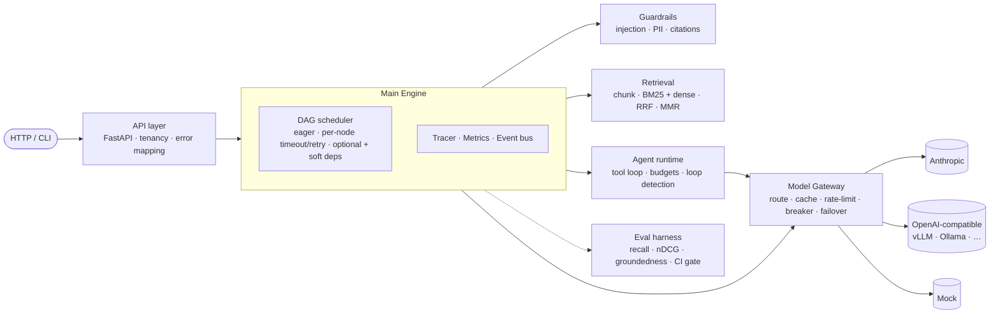
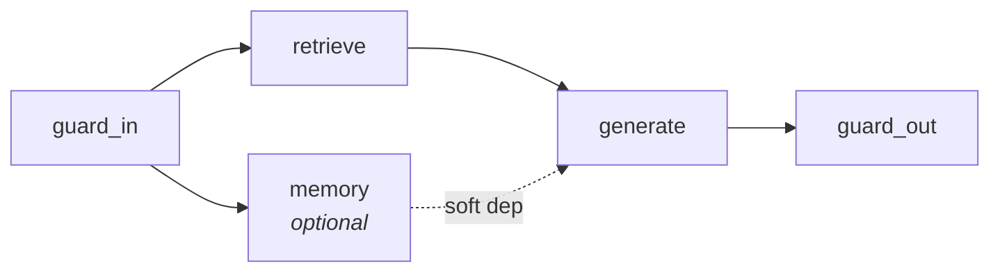

# Meridian

**A production-style LLM orchestration engine: one async core that runs five sub-engines — model gateway, hybrid retrieval, guardrails, agent runtime and evals.**

[](https://github.com/Ajay702/meridian-engine/actions/workflows/ci.yml)


Most LLM demos are one prompt plus one API call. Real systems need more. They route between models by cost and latency and fail over when a provider goes down. They retrieve from a changing corpus, stop prompt injection, redact PII, keep agents from looping, put a price on every token and fail CI when answer quality drops. Meridian is the layer that does this work, built as small parts that each do one job.

It runs **fully offline** by default: a deterministic extractive mock model and a hashing embedder let the whole system run in CI with no API key. To use real models, set `ANTHROPIC_API_KEY` or point it at any OpenAI-compatible endpoint (vLLM, Ollama, Together…).

```bash
pip install -e '.[dev]'
meridian ask "What service credit applies below 99.0 percent uptime?" --trace
```
```
Below 99.0 percent the credit rises to 25 percent. [1] If monthly uptime falls below
99.95 percent, Business customers receive a 10 percent service credit. [1]

  [1] sla › Service Level Agreement > Service Credits  (score 0.0328)
  ...
  model=mock-large latency=1.5ms cost=$0.001830 chunks_indexed=11 trace=4a052fd7ba9c
        2.92ms  pipeline.ask
        0.04ms    ask.guard_in
        0.17ms    ask.retrieve
        0.15ms      retrieval.search
        0.01ms    ask.memory
        2.55ms    ask.generate
        2.53ms      gateway.complete
        0.18ms        provider.call
        0.03ms    ask.guard_out
```

---

## Architecture



The rule that makes this work: **sub-engines never import each other**. Only the main engine composes them. You can test, replace or move any one of them into its own service without touching the rest. Details are in [docs/ARCHITECTURE.md](docs/ARCHITECTURE.md).

### Request lifecycle — `POST /v1/ask`



`retrieve` and `memory` run at the same time. `memory` is optional and is only a *soft* dependency of `generate`. If the session store is down, the answer still comes back, minus conversation history, and the response lists `"degraded": {"memory": "..."}`. Every node gets its own span, timeout and retry policy.

---

## The sub-engines

| Sub-engine | What it does | Key ideas |
|---|---|---|
| **Main engine** · [`core/pipeline.py`](src/meridian/core/pipeline.py) | Async DAG executor | Eager scheduling (a node starts as soon as its deps finish, not level by level). Cycle detection. Per-node timeout, retry with jitter, optional nodes, soft deps. Cancels sibling tasks when a node fails. |
| **Model Gateway** · [`gateway/`](src/meridian/gateway/gateway.py) | Every LLM call goes through it | Routes by policy (`cost` · `latency` via EWMA · `quality`). Ranked fallback chain. Per-provider **circuit breaker** (closed/open/half-open). **Token-bucket** rate limiting. Full-jitter retries. Per-tenant **budgets** and cost accounting. Context-window filtering. |
| **Semantic cache** · [`gateway/cache.py`](src/meridian/gateway/cache.py) | Avoids paying twice for the same answer | Exact hash tier plus an embedding-similarity tier. The cache key is scoped by tenant, model, prior turns and retrieved chunk ids, so two different questions over the same context can't collide ([ADR-0003](docs/adr/0003-semantic-cache-scoping.md)). Only deterministic requests are cached. TTL and LRU limits. |
| **Retrieval** · [`retrieval/`](src/meridian/retrieval/engine.py) | Hybrid search | Structure-aware recursive chunker that keeps heading paths. Okapi BM25 inverted index plus a flat cosine vector index. Both support upserts and filter *before* scoring. **Reciprocal Rank Fusion** merges the two rankings, then **MMR** removes near-duplicates. |
| **Guardrails** · [`guardrails/`](src/meridian/guardrails/engine.py) | Policy enforcement | Weighted prompt-injection scoring. PII redaction for email, card (with a **Luhn check**), SSN, phone, IP and API keys. Citation validation. Each check returns a structured `Verdict` that is counted and logged. |
| **Agent runtime** · [`agents/`](src/meridian/agents/runtime.py) | Bounded tool-use loop | Tool JSON-schemas are built from Python type hints, and calls are validated with pydantic. Parallel tool execution. Tool errors go back to the model as observations so it can recover. Hard limits on steps, time and cost, plus **repeated-call loop detection**. |
| **Evals** · [`evals/harness.py`](src/meridian/evals/harness.py) | Quality gate | Measures recall@k, MRR, nDCG@k, groundedness, citation validity, answer match, p50/p95 latency and cost. `--gate metric=min` exits non-zero when a metric drops, and CI runs it on every push. |
| **Providers** · [`gateway/providers/`](src/meridian/gateway/providers/http.py) | Vendor adapters | Anthropic Messages API (tool_use / tool_result mapping) and OpenAI-compatible chat completions. Pooled `httpx` clients. Status codes are mapped onto retryable vs. fatal errors. |

Cross-cutting infrastructure, all with zero extra dependencies:
- **Tracing**: spans propagate through `contextvars` and stay correct across `asyncio.gather`. The shape matches OpenTelemetry, and `GET /v1/traces/{id}` returns the span tree.
- **Metrics**: Prometheus counters and histograms (requests, tokens, cost per tenant, cache hit/miss, guardrail actions, latency buckets) at `GET /metrics`.
- **Event bus**: glob-pattern pub/sub (`gateway.*`, `guardrail.blocked`) for audit logs, billing or webhooks. A failing handler never breaks the code that published the event.

---

## Benchmarks

Measured on an Apple M4 laptop, Python 3.13, single process, offline mock provider (no API key). Engine numbers are the range over 3 runs of `python benchmarks/bench.py`.

**What these numbers mean:** the mock provider answers instantly (or with a fixed simulated delay), so they measure **Meridian's own overhead**, not model speed. With a real model, add the provider's latency (usually 0.5–5 s) on top of these.

### Engine

| Scenario | Result |
|---|---|
| **Chaos failover**: 1,000 requests, primary provider fails 30% of calls (40 ms simulated latency) | **86.6–88.9% → 100.0%** success with failover on. p50 unchanged (40.6 ms). p95 rises from ~160 ms to ~200 ms, because a failed call is retried on the backup |
| **Hybrid retrieval**: 7,122 chunks, dense + BM25 + RRF + MMR | **p50 4.6–4.8 ms**, p95 4.9–5.1 ms per query; 2,000–2,400 chunks/s ingest |
| **Semantic cache**: 500 requests across 4 intents with case/punctuation variants | **99.2% hit rate**, 4 provider calls, 0.3 ms mean vs. ~30 ms uncached |
| **Eval suite**: 12 labelled questions ([examples/eval.jsonl](examples/eval.jsonl)) | recall@5 1.00 · MRR 1.00 · groundedness 1.00 · answer match 1.00 · p50 4.1 ms |

### HTTP API, end to end

`benchmarks/http_load.py` ingests the sample corpus over HTTP, then sends 3,000 `POST /v1/ask` requests and **checks every answer against the labelled expected text**, not just the status code. Server and load generator ran on the same laptop, single uvicorn worker.

| Setup | Concurrency | Throughput | p50 | p95 | p99 | Correct answers |
|---|---:|---:|---:|---:|---:|---:|
| Cache off, no rate limit | 1 | 857 req/s | 1.1 ms | 1.3 ms | 1.7 ms | 100% |
| Cache off, no rate limit | 32 | 533 req/s | 44 ms | 157 ms | 234 ms | 100% |
| Cache on, no rate limit | 32 | 520 req/s | 45 ms | 141 ms | 230 ms | 100% |
| **Default config** (600 rpm per provider) | 32 | **10 req/s** | 3.2 s | 3.2 s | 3.2 s | 100% |

The last row is the rate limiter doing its job: by default each provider is limited to 600 requests per minute, so extra requests queue instead of failing. Raise `rpm` under `[[providers]]` to match your provider's real limit. At 32 concurrent connections, a single Python worker is the bottleneck. Run more uvicorn workers for more throughput.

To reproduce:

```bash
make bench
meridian --config meridian.example.toml serve --port 8080 &
python benchmarks/http_load.py --url http://127.0.0.1:8080 --requests 3000 --concurrency 32
```

### Limits of these numbers

The eval and cache numbers come from a deliberately small, easy sample set (simple paraphrases, a 5-document corpus). They show the system working end to end. They are not leaderboard claims. Point the harness at your own corpus and labelled questions to get meaningful scores.

---

## Quickstart

```bash
make install          # uv venv + editable install with dev tools
make test             # 52 tests: pipeline, resilience, gateway, providers, retrieval, guardrails, agent, API
make eval             # eval harness with CI thresholds
make bench            # benchmarks above
make serve            # API on :8080
docker compose up     # API + Prometheus on :9090
```

### HTTP API

```bash
curl -X POST localhost:8080/v1/documents -H 'content-type: application/json' \
  -d '{"id":"refunds","text":"# Refunds\n\nCard refunds take 5 to 10 business days.","metadata":{"team":"billing"}}'

curl -X POST localhost:8080/v1/ask -H 'X-Tenant-ID: acme' -H 'content-type: application/json' \
  -d '{"question":"How long do card refunds take?","filters":{"team":"billing"},"session_id":"u-42"}'

curl -X POST localhost:8080/v1/completions -H 'content-type: application/json' \
  -d '{"messages":[{"role":"user","content":"hi"}],"policy":"cost"}'

curl localhost:8080/v1/traces/<trace_id>     # span tree
curl localhost:8080/v1/providers             # breaker state + latency EWMA
curl localhost:8080/metrics                  # Prometheus
```

| Error | Status |
|---|---|
| Guardrail block (`reasons` included) | 422 |
| Tenant budget exceeded | 402 |
| Rate limited | 429 |
| No healthy provider | 503 |

### As a library

```python
from meridian import Engine
from meridian.agents.tools import ToolRegistry

engine = Engine()
await engine.ingest_path("docs/")
res = await engine.ask("What is our data retention period?", filters={"team": "legal"})
print(res.answer, res.sources, res.cost_usd, res.trace_id)

tools = ToolRegistry()

@tools.tool
async def lookup_invoice(invoice_id: str) -> dict:
    """Fetch an invoice by id."""
    ...

result = await engine.agent(tools, system="You are a billing assistant.").run("Why was INV-88 charged twice?")
print(result.output, result.stop_reason, result.cost_usd)
```

### Real models

```toml
# meridian.toml  (see meridian.example.toml)
[[providers]]
name = "anthropic"
kind = "anthropic"
api_key_env = "ANTHROPIC_API_KEY"

[[providers]]
name = "vllm"
kind = "openai_compatible"
base_url = "http://vllm:8000/v1"

[[models]]
name = "claude-sonnet-5-5"
provider = "anthropic"
input_per_mtok = 3.0
output_per_mtok = 15.0
quality = 0.92
```

Any key can be overridden from the environment: `MERIDIAN__GATEWAY__TENANT_BUDGET_USD=25`.

---

## Project layout

```
src/meridian/
  engine.py              main engine: composes sub-engines into pipelines
  core/                  pipeline DAG · tracing · metrics · events · config · types · errors
  gateway/               router + failover · semantic cache · resilience · providers/
  retrieval/             chunking · embeddings · BM25 + vector indexes · hybrid engine
  guardrails/            injection · PII · citation checks
  agents/                tool registry (schema from type hints) · bounded runtime
  evals/                 metrics + regression harness
  api/server.py          FastAPI service
benchmarks/bench.py      chaos / retrieval / cache benchmarks
docs/                    architecture + ADRs
```

## Design decisions

- [ADR-0001](docs/adr/0001-sub-engine-boundaries.md): sub-engines never import each other
- [ADR-0002](docs/adr/0002-exact-vector-search-first.md): exact vector search first, ANN behind the same interface later
- [ADR-0003](docs/adr/0003-semantic-cache-scoping.md): scope the semantic cache by context, not just similarity
- [ADR-0004](docs/adr/0004-offline-by-default.md): offline by default, with a deterministic mock model

## Roadmap

- Streaming responses (SSE) through the gateway, with cost charged as tokens arrive
- Redis-backed cache, session memory and rate limits for multi-replica deployments
- OTLP exporter for the tracer; ANN backend (HNSW) for the vector index
- LLM-as-judge groundedness for the eval harness, alongside the lexical metric

## License

MIT
